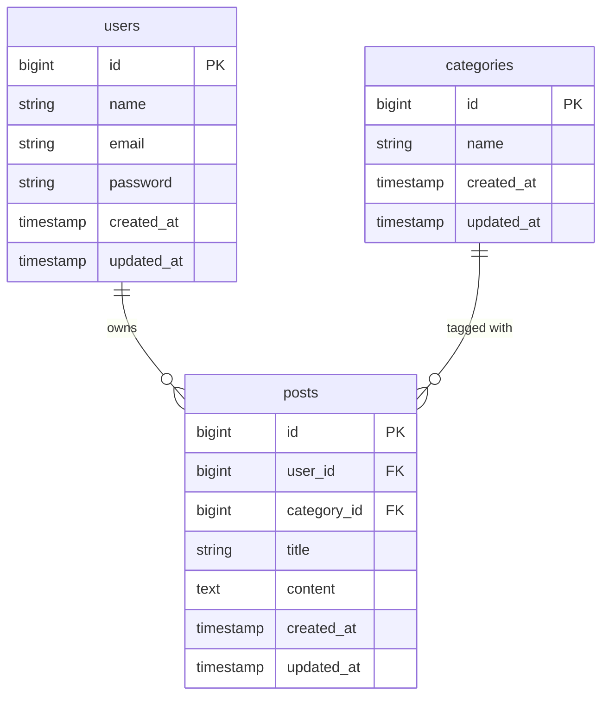

# 新規ポスト作成機能 設計書

## 概要

ログインユーザーが新しいポストをタイムラインに投稿できるようにする。

現状はタイムライン閲覧・自分の既存ポストの編集・削除しかできない。
本機能の追加により、ユーザーがタイトル・トピック・本文を入力して送信すると
タイムラインの先頭にそのポストが追加される。

UI 方式は**別ページ遷移**とする。タイムライン画面のヘッダーに「新規作成」ボタンを配置し、
押下で `/posts/create` へ遷移、フォームを送信するとタイムラインへリダイレクトする。

---

## 受け入れ条件

| # | 条件 |
|---|---|
| 1 | ログインした状態でタイムラインを開くと、「新規作成」ボタンが表示される |
| 2 | ボタンを押すと `/posts/create` に遷移し、タイトル・トピック・本文の入力フォームが表示される |
| 3 | タイトル・トピック・本文をすべて入力して送信すると、タイムラインの先頭にそのポストが追加される |
| 4 | 増えたポストには自分の名前が表示され、編集・削除ボタンが出る |
| 5 | 本文が空のまま送信すると、エラーが表示されてポストは増えない |
| 6 | ログアウトした状態で `/posts/create` を直接開くと、ログイン画面にリダイレクトされる |

---

## 変えないもの

- 既存のルート（`posts.index` / `posts.edit` / `posts.update` / `posts.destroy`）の仕様
- Post モデルのフィールド構成（`user_id` / `category_id` / `title` / `content`）
- 編集・削除の認可ロジック（`PostPolicy`）
- タイムラインの表示順・表示内容（投稿者名・カテゴリバッジ・編集削除ボタンの出し分け）
- auth ミドルウェアによるルート保護の方針

---

## 増えるテーブル

新しいテーブルは**増えない**。
既存の `posts` テーブルがすでに必要なカラム（`user_id` / `category_id` / `title` / `content`）をすべて持っているため、マイグレーションは不要。

参考として、本機能に関係するテーブルの構成を示す。



---

## 増える画面

### 1. タイムライン画面（既存）に追加

`GET /posts`（`posts.index`）のヘッダー部に「新規作成」ボタンを追加する。

```
┌─────────────────────────────────────┐
│  Post App   username@example.com    │
│  [新規作成]              [ログアウト] │
├─────────────────────────────────────┤
│  投稿カード一覧...                    │
└─────────────────────────────────────┘
```

### 2. ポスト作成画面（新規）

`GET /posts/create`（`posts.create`）

| 項目 | 要素 | 備考 |
|---|---|---|
| タイトル | `<input type="text" name="title">` | 必須 |
| トピック | `<select name="category_id">` | カテゴリ一覧をプルダウンで選択 |
| 本文 | `<textarea name="content">` | 必須・最大140字 |
| 送信ボタン | `<button type="submit">` | 押下で `POST /posts`（`posts.store`）へ送信 |
| キャンセル | タイムラインへのリンク | フォームを破棄してタイムラインへ戻る |

送信成功後は `posts.index`（タイムライン）へリダイレクト。

---

## 入力チェックとメッセージ一覧

### バリデーションルール

| フィールド | ルール |
|---|---|
| `title` | required / string / max:255 |
| `content` | required / string / max:140 |
| `category_id` | required / exists:categories,id |

`user_id` はフォーム入力ではなく、コントローラで `auth()->id()` を自動セットする。

### エラーメッセージ

| フィールド | ルール違反 | 表示メッセージ |
|---|---|---|
| `title` | 未入力 | タイトルは必須です。 |
| `title` | 255字超過 | タイトルは255字以内で入力してください。 |
| `content` | 未入力 | 本文は必須です。 |
| `content` | 140字超過 | 本文は140字以内で入力してください。 |
| `category_id` | 未選択 | トピックを選択してください。 |
| `category_id` | 不正な値 | 有効なトピックを選択してください。 |

---

## テスト観点

| # | 観点 | 操作 | 期待結果 |
|---|---|---|---|
| 1 | ボタン表示 | ログイン後にタイムラインを開く | 「新規作成」ボタンが表示される |
| 2 | 未認証リダイレクト | ログアウト状態で `/posts/create` を直接開く | ログイン画面へリダイレクトされる |
| 3 | 正常投稿 | 全項目を入力して送信 | タイムライン先頭に新しいポストが表示され、自分の名前・編集・削除ボタンが出る |
| 4 | 本文空エラー | 本文を空にして送信 | エラーメッセージが表示され、ポストは増えない |
| 5 | タイトル空エラー | タイトルを空にして送信 | エラーメッセージが表示され、ポストは増えない |
| 6 | トピック未選択エラー | トピックを選ばずに送信 | エラーメッセージが表示され、ポストは増えない |
| 7 | 本文140字超エラー | 本文を141字以上入力して送信 | 「本文は140字以内で入力してください。」が表示され、ポストは増えない |
| 8 | 他人の投稿 | 別ユーザーの投稿を表示 | 編集・削除ボタンが出ない（既存動作の確認） |
