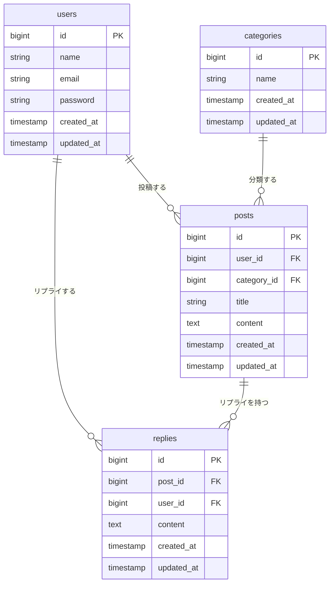

# リプライ機能 設計書

関連 Issue: #1

---

## 概要

タイムラインのポストに対してリプライを投稿・削除できる機能を追加する。
現状はポストの一覧・編集・削除のみで、読んだ人が返事を送る手段がない。
ポストの詳細画面（新規追加）を起点とし、リプライの一覧表示・投稿・削除を実現する。

---

## 受け入れ条件

1. ポストを1件開くと、そのポストの内容とリプライの一覧が見える
2. ログイン済みユーザーが本文を入力してリプライを送ると、一覧に追加される
3. 本文が空のまま送信すると、エラーが表示されてリプライは保存されない
4. 本文が141字以上のまま送信すると、エラーが表示されてリプライは保存されない
5. 自分が投稿したリプライは削除できる
6. 他人が投稿したリプライは削除できない（削除ボタンが表示されない）
7. 未ログインのユーザーはリプライ詳細画面へのアクセス自体をリダイレクトされる

---

## 変えないもの

- `GET /posts` — タイムライン（一覧）の表示
- `GET /posts/{post}/edit` — 投稿の編集画面
- `PUT /posts/{post}` — 投稿の更新
- `DELETE /posts/{post}` — 投稿の削除
- `app/Policies/PostPolicy.php` の内容

---

## 増えるテーブル

### replies テーブル定義

| カラム | 型 | 制約 | 説明 |
|-------|----|------|------|
| id | bigint unsigned | PK, AUTO_INCREMENT | |
| post_id | bigint unsigned | FK → posts.id, CASCADE ON DELETE | 対象ポスト |
| user_id | bigint unsigned | FK → users.id, CASCADE ON DELETE | 投稿者 |
| content | text | NOT NULL | 本文（上限 140 字はアプリ側で検証） |
| created_at | timestamp | nullable | |
| updated_at | timestamp | nullable | |

外部キーの CASCADE 設定:
- `posts` を削除すると、そのポストへのリプライも削除される
- `users` を削除すると、そのユーザーのリプライも削除される

### ER 図

---

## 増える画面

### ポスト詳細画面（新規）

**ルート:** `GET /posts/{post}` → `posts.show`

表示内容:
- ポストのタイトル・本文・投稿者名・カテゴリ・投稿日時
- リプライの一覧（投稿者名・本文・投稿日時・自分のリプライには削除ボタン）
- リプライ投稿フォーム（本文テキストエリア・送信ボタン）

タイムラインの各ポストからこの画面へのリンクを追加する（タイムライン自体の構成は変えない）。

### 増えるルート一覧

| メソッド | URI | コントローラー | 名前 |
|---------|-----|--------------|------|
| GET | `/posts/{post}` | `PostController@show` | `posts.show` |
| POST | `/posts/{post}/replies` | `ReplyController@store` | `replies.store` |
| DELETE | `/replies/{reply}` | `ReplyController@destroy` | `replies.destroy` |

### 増えるファイル

| ファイル | 役割 |
|---------|------|
| `app/Models/Reply.php` | Reply モデル |
| `app/Http/Controllers/ReplyController.php` | リプライの作成・削除 |
| `app/Policies/ReplyPolicy.php` | リプライ削除の認可（PostPolicy に揃える） |
| `database/migrations/xxxx_create_replies_table.php` | replies テーブルのマイグレーション |
| `resources/views/posts/show.blade.php` | ポスト詳細画面の Blade テンプレート |

---

## 入力チェックとメッセージ一覧

対象フォーム: リプライ投稿フォーム（`ReplyController@store`）

| フィールド | ルール | エラーメッセージ |
|-----------|-------|----------------|
| `content` | required | 本文を入力してください。 |
| `content` | max:140 | 本文は140字以内で入力してください。 |

---

## テスト観点

### 表示

- 認証済みユーザーがポスト詳細画面を開くと、ポストの内容が表示される
- ポストにリプライが0件のとき、リプライ一覧は空で表示される
- ポストにリプライが複数件あるとき、全件表示される
- 自分のリプライには削除ボタンが表示される
- 他人のリプライには削除ボタンが表示されない

### リプライ作成

- 本文を入力して送信すると、一覧にリプライが追加される
- 送信後、同じ詳細画面にリダイレクトされる
- 本文が空のまま送信すると、エラーが表示されてリプライは増えない
- 本文が141字のまま送信すると、エラーが表示されてリプライは増えない
- 本文が140字ちょうどで送信すると、正常に保存される

### リプライ削除

- 自分のリプライの削除ボタンを押すと、リプライが削除される
- 削除後、同じ詳細画面にリダイレクトされる
- 他人のリプライの削除エンドポイントへ直接リクエストすると 403 になる

### 認証

- 未ログイン状態でポスト詳細画面にアクセスすると、ログイン画面にリダイレクトされる
- 未ログイン状態でリプライ作成エンドポイントへ POST すると、ログイン画面にリダイレクトされる
